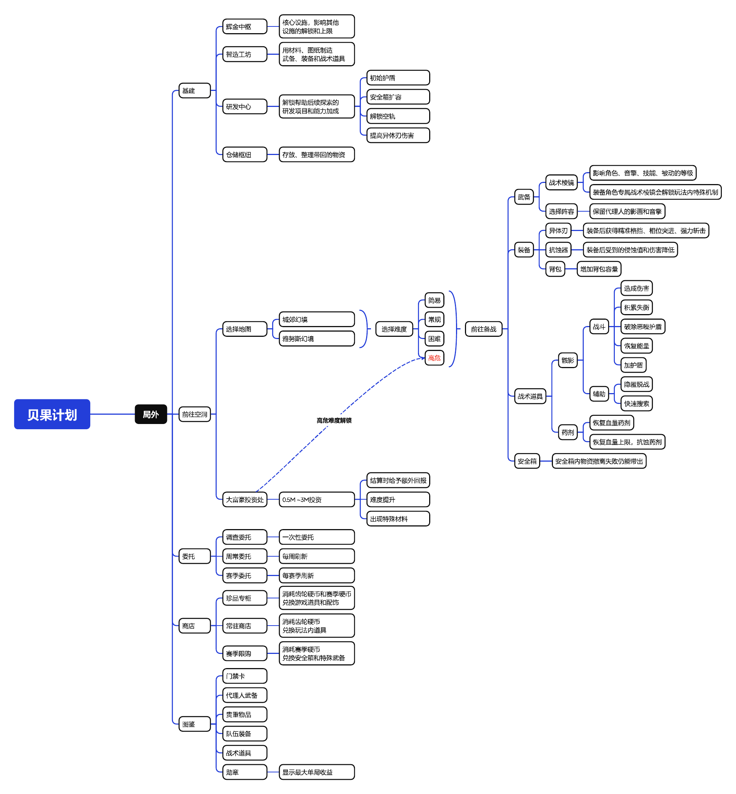
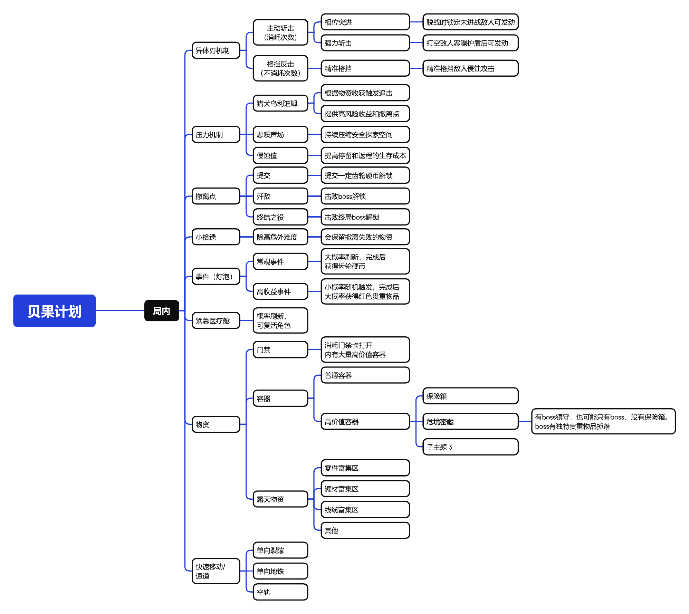

## 01 · 玩法概述与拆解问题

### 1.1 玩法定位与核心循环

《迷宫诡域：贝果计划》是《绝区零》的常驻 PvE 搜打撤玩法。玩家在局外选择地图与难度、准备武备和战术道具；进入空洞后搜集物资、完成委托、应对敌人与环境威胁，并在继续搜索和及时撤离之间做出选择。成功带回的物资可用于研究站建设、装备制作与能力研发，形成“备战—探索—撤离—成长—再次入场”的循环。

从个人体验来看，贝果计划将绳匠引导队伍穿行空洞的世界观设定转化为实际玩法，让玩家获得接近“盗洞客”冒险的体验。研究站成长、装备制作和任务系统也为玩家提供了持续游玩的目标。

该玩法最值得分析的设计问题，是如何在缺少真人对抗的 PVE 环境中持续制造风险，并让玩家主动判断撤离时机。与此同时，较长的单局流程与持续的战斗压力，也使它与《绝区零》原有的短时战斗体验存在明显差异，玩法深度、单局负担与整体体验节奏之间的关系值得进一步研究。

### 1.2 核心问题一：怎样让撤离具有成功感？

**Q1：《贝果计划》与《三角洲行动》“行动”模式，如何让玩家感到一次撤离是成功的？**

贝果计划通过高价值物资、逐步升级的系统威胁和撤离后的成长收益，建立从风险决策到成功反馈的完整循环。

《三角洲行动》的真人对抗能够带来难以预测的威胁，玩家可能因其他玩家的埋伏、交战或撤离竞争而改变计划。

《贝果计划》主要依靠系统机制提供压力。猎犬乌利迪姆追击玩家，恶噪声场逐渐扩大，侵蚀值则进一步增加探索的生存成本。这些机制迫使玩家重新评估继续搜索的收益与安全撤离的可能性。

成功撤离的价值还体现在局外成长。玩家带回的物资能够用于研究站建设、装备制作和能力研发，使单局探索的收益延续到下一局。这样，撤离既是结束当前风险的决策，也是推进长期成长的必要环节。

### 1.3 核心问题二：怎样让玩家主动决定撤离？

**Q2：贝果计划的不同难度或区域，如何让玩家从“敢继续搜”变为“需要尽快撤”？**

玩家会根据新增收益的预期、已有物资的价值、剩余时间、撤离路线和当前生存状态决定是否继续搜索。随着收获增加，失败可能造成的损失也随之提高；猎犬干扰搜索，恶噪声场逐渐压缩安全探索空间，侵蚀值降低队伍的生存容错。多种压力共同作用，使玩家需要不断重新评估继续搜索的价值。

难度改变探索的成本与容错空间。玩家可以在入局前选择难度，高危难度还可以通过“大富豪投资”调整风险与回报。以第二赛季新增的高额投资档位为例，猎犬增加了控制招式，终局Boss和撤离点Boss对骸影的抗性提高。这意味着玩家可能需要投入更多战斗时间和消耗品才能完成相同目标。当队伍战斗能力不足或物资已经具有较高价值时，继续挑战高风险目标的吸引力就可能下降。区域差异则改变玩家对搜索路线的选择。 地图中存在普通容器、保险箱、金色灯泡隐藏任务以及由 Boss 镇守的危境密藏等搜索目标。不同目标的潜在收益、战斗成本和可达条件并不相同。玩家需要结合当前位置、目标价值、撤离点距离及剩余时间，判断是否值得绕路搜索。例如，面对远离撤离路线、需要击败 Boss 才能获取的高价值目标，玩家可能选择继续冒险，也可能放弃额外收益，优先保全现有物资。

随着单局推进，原本合理的搜索计划也可能不再划算。 物资价值累积可能触发猎犬追击，恶噪声场随时间扩大并改变安全通行条件，侵蚀值则持续降低队伍的生存容错。部分撤离点还会随时间关闭。即使玩家最初有能力搜索整片区域，也需要在探索过程中不断重新评估路线与撤离时机。

从设计目的来看，难度和区域并不直接规定玩家何时撤离，而是改变不同选择的风险与收益；猎犬、恶噪声场和侵蚀则进一步让这种关系随时间发生变化。玩家从“敢继续搜”到“需要尽快撤”，本质上不是简单的战斗难度提升，而是继续探索的预期收益逐渐难以抵消失败损失和返程风险。
这一机制使撤离成为贯穿单局的动态决策，而非探索结束后的固定步骤。不过，更高难度不一定意味着玩家必然更早撤离，高风险也可能伴随更高收益。实际选择仍取决于玩家装备、操作能力和当前目标。
具体机制与案例详见后文。

### 1.4 玩法整体结构

局外与局内结构分别展示；点击图片可全屏查看，使用“原始大小”阅读细节。

<figure class="mindmap-card"><figcaption>局外系统与入局准备</figcaption><small class="view-large">点击图片查看大图</small></figure>
<figure class="mindmap-card"><figcaption>局内机制与探索撤离</figcaption><small class="view-large">点击图片查看大图</small></figure>

---

## 02 · 局外系统：成长、任务与资源回流

### 2.1 系统入口与主要界面

**系统入口**

第一种：F2快捷手册/tab轮盘划快捷手册点击确定 → 周期征讨 → 迷宫诡域→前往

<small class="fig-caption">图 03 · 快捷手册中的迷宫诡域入口</small>

第二种：M键打开地图→快捷导航→奥蒙德研究站→迷宫诡域→对话达塔

**系统界面**

<small class="fig-caption">图 04 · 研究站一级界面及功能入口</small>

一级界面包含：从左到右，从上到下，依次为：退出按钮，系统名，勋章，辉金中枢，智造工坊，研发中心，仓储枢纽，哨站后勤（贝果计划产出零号业绩，可以在此将零号业绩兑换为游戏资源），赛季回顾，赛季等级+赛季委托，图鉴，商店，调查委托，周常委托，前往空洞。

### 2.2 研究站设施与局外养成

**主要设施**

辉金中枢：研究站建设与升级的核心，影响其他设施的解锁和等级上限。

智造工坊：用材料、图纸制造入局所需的武备、装备和战术道具。

研发中心：解锁帮助后续探索的研发项目与能力加成。

仓储枢纽：存放、整理带回的物资。

以上四个共用一个二级界面

<small class="fig-caption">图 06 · 研究站设施的共用二级界面</small>

### 2.3 委托与赛季目标

**赛季等级 + 赛季委托：从新手引导到周期性参与**

<small class="fig-caption">图 07 · 赛季等级及委托界面</small>

包含调查委托，周常委托，赛季委托。一级页面会展示赛季委托结算倒计时，类似红点设计，提醒并鼓励玩家游玩。

#### 调查委托：一次性玩法引导

一次性任务，围绕辉金中枢、智造工坊、研发中心、仓储枢纽、桶之愚者等设施，以及骸影等特殊道具设置目标，引导玩家逐步接触局外养成与局内探索系统。奖励少量菲林（抽卡资源），齿轮硬币及玩家经验。

#### 周常委托：每周周期任务

每周刷新，并与零号空洞原有的每周悬赏奖励进度关联。玩家每周累计达到8000积分即可完成对应奖励目标。根据现有任务记录，全部周常委托提供的积分约为20000分，高于每周奖励门槛。为不同玩家准备不同的完成方式，任务主要覆盖搜索、战斗、撤离三类行为，例如开启指定容器、上交物资、在规定难度击败特定敌人，或完成指定收益的撤离目标。

#### 赛季委托：赛季阶段目标

分四个阶段，每个阶段任务完成后解锁下一阶段，随赛季更新任务和奖励。

任务内容与调查、周常委托存在一定重叠，主要围绕玩法机制、探索收益和高难度挑战展开。完成后可获得赛季经验、赛季硬币等资源，用于推进赛季成长与奖励兑换。

个人推测之后赛季委托会围绕每赛季更新的特色，参考三角洲每赛季的3*3任务。

### 2.4 委托设计对玩家行为的影响

调查委托为新玩家提供了明确的短期目标。玩家不需要一次性理解所有设施与道具，而是可以跟随任务逐步解锁功能、尝试操作，并在获取奖励的过程中建立对玩法循环的认识。

周常委托通过每周刷新的任务目标，将贝果计划与周期性奖励绑定。任务覆盖搜索、战斗和撤离等行为，为不同游玩偏好的玩家提供多种完成路径。每周的积分要求提供了明确的参与目标，而全部任务的可获得积分明显高于要求，也允许玩家选择更适合自己的任务组合。

例如，偏好搜索的玩家可以优先完成容器与物资相关任务；擅长战斗的玩家则可能选择击败敌人或高难度撤离任务。当多个委托目标能够在同一局内完成时，玩家还有动力主动规划搜索路线、战斗目标和撤离时机，提高单局任务完成效率。

赛季委托则提供更长期的目标。四阶段递进结构使玩家在完成当前任务后仍有新的目标可以追求，而赛季倒计时与限定奖励则可能影响玩家的时间安排，促使其在赛季结束前集中完成尚未解锁或完成的任务。

**实际体验与结果｜玩家获得了什么，又付出了什么？**

这套任务系统为玩家提供了短期引导、周期奖励与长期目标，也让不同类型的玩家能够在一定程度上自主决定任务完成方式。

但任务选择自由并不代表实际完成成本相同。贝果计划的单局探索包含物资搜索、战斗、路线规划和撤离风险，相比部分传统零号空洞玩法，可能需要更多操作时间与注意力。如果玩家只是为了领取每周奖励，那么委托效率、单局耗时及失败损失就会直接影响其参与意愿。

2026年10月5日，Reddit 社区一项关于贝果计划参与频率的自发调查，统计了74份回复。其中17人表示仍经常游玩，22人表示每周或偶尔游玩，35人表示已经停止参与。

具体评论中，部分玩家表示仅为了完成周常任务而进入贝果计划，也有玩家认为旧零号空洞模式完成奖励更高效，因此选择返回旧玩法。与此同时，中文社区中也存在持续冲榜、每日多次游玩的玩家，说明玩法本身仍能吸引部分玩家主动重复体验。

这些反馈表明，周期性奖励能够维持部分玩家的参与，但参与意愿还受到玩法兴趣、任务效率、操作成本和奖励获取进度的共同影响。

<small class="fig-caption">图 08 · Reddit 社区自发调查的参与频率统计（74 份回复）</small>

**社区讨论来源：** [Reddit 原帖](https://www.reddit.com/r/ZZZ_Discussion/comments/1wyhwcg/how_often_are_people_playing_operation_bagel/) · [巴哈姆特讨论](https://forum.gamer.com.tw/C.php?bsn=74860&snA=10780) · [TapTap 讨论](https://www.taptap.cn/moment/843264661284454483)

> 调查来自自愿参与的社区样本，只能说明受访者的不同选择，不能直接推算全部玩家的参与比例。

### 2.5 勋章、图鉴与商店

**勋章**：详细展示当前已达到的勋章阶段和可达到的阶段及其条件和对应的勋章变化，激发玩家动力

<small class="fig-caption">图 05 · 勋章的等级阶段与奖励展示</small>

图鉴：包括门禁卡，代理人武备，贵重物品，队伍装备，战术道具，也有勋章的展示，还有绳网（游戏内）分享和社群（游戏外）分享，主要是激起玩家的全收集欲和展示欲。

<small class="fig-caption">图 10 · 图鉴与收集进度界面</small>

**商店**

<small class="fig-caption">图 11 · 研究站商店及兑换商品</small>

珍品专柜：使用齿轮硬币和赛季硬币兑换，

常驻商店：使用齿轮硬币兑换战备、蓝图和材料等功能内玩法道具。

赛季限购：使用赛季硬币兑换功能内限购道具，

### 2.6 撤离收益如何进入下一轮成长

<small class="fig-caption">图 09 · 局外成长 × 备战 × 再次探索机制联系图</small>

---

## 03 · 入局准备：难度、投资与战术配置

### 3.1 地图、难度与入局流程

<small class="fig-caption">图 12 · 地图与难度选择界面</small>

选择地图→选择难度→前往备战→前往空洞→进入游戏

前往空洞→（若为高危难度）→大富豪投资处→进入游戏

进入前会显示终局boss的情报

### 3.2 大富豪投资：风险与回报

三级界面大富豪投资处：min,-1M,-500K,+500K,+1M,MAX

<small class="fig-caption">图 13 · 高危难度的大富豪投资设置</small>

根据入局前的投资金额，会给予额外的回报，同时第二赛季（3.2版本）把投资上限提高到3M齿轮硬币，该档位下难度提升，主要是猎犬招式变多，增加控制技，终局boss和撤离点boss对骸影的抗性变高。

### 3.3 战术棱镜与玩法内成长

**战术棱镜**：是代理人的武备，即常说的装备。此玩法中，代理人的影画和音擎会保留，但等级、技能以及音擎等级都会受武备等级影响。如图。

该设计保留了账号养成投入，同时控制玩法内的成长曲线。 前者让原有角色投入继续产生价值，后者让玩家仍然需要通过玩法内成长提高战斗能力。相应的代价是，玩家需要额外理解和培养一套玩法内成长体系。这种设计可能兼顾已有角色资产与独立玩法的成长需求，但也可能增加理解和养成负担。

<small class="fig-caption">图 14 · 战术棱镜与代理人等级关联界面</small>

### 3.4 队伍装备：异体刃、抗蚀器与背包

装备：包括异体刃、抗蚀器、背包

异体刃：该玩法特有的机制，也是队伍装备的一部分，在敌人未索敌到玩家时，或者将敌人的恶噪护盾打空，和格挡一定次数敌人侵蚀攻击时（小怪1次，精英2次，boss3次），可以按R锁定敌人，让佩洛伊斯对其发动强力斩击，对boss和精英造成百分比伤害，直接斩杀小怪。格挡触发的斩击不消耗异体刃的使用次数。在前期队伍不强时，异体刃是玩家的伤害保底，在后期玩家全装时，异体刃也是玩家伤害的重要组成。异体刃分三种，格挡、强斩、突进。实际游玩中区别不大。高级异体刃会有额外的强化效果，主要是伤害和失衡值两方面。

### 3.5 战术道具与隐匿玩法

战术道具：有四个快速使用栏位放置道具，一局最多带12个同种骸影/药品。药品分为恢复血量的药剂和恢复血量上限的抗蚀药剂，骸影大体可分为战斗型和辅助型，战斗型可分为造成伤害/积累失衡/破除恶噪护盾/恢复代理人能量/为代理人加护盾，辅助型可分为隐匿脱战/快速搜索。隐匿时还可互动，也就是说可以不打boss，靠隐匿开启撤离点，但boss没死情况下开启撤离点耗时很长，刚好跟骸影的隐匿时长差不多，非常刺激。隐匿可以脱战，也就是说可以异体刃斩击进入战斗→隐匿脱战→再次斩击，可以短时间造成高伤害逃课。

<small class="fig-caption">图 15 · 异体刃 × 隐匿骸影 × 撤离点策略联系图</small>

### 3.6 物资类型与背包价值

贵重物品：换金道具，一格只能堆叠一个，红色品质有图鉴，放入背包时还有动画。

门禁卡：不同门禁卡可以开启地图内对应房间门禁，获取大量物资。商店可以高价购买，直接卖很便宜，很亏，一般不会有玩家这样做，也是鼓励玩家搜到后带入局内消耗。

其他：主要是各类基建升级和科技树升级的材料，还有其他道具的制造材料，一格可以堆叠20个，堆满单格价值也不低。

---

## 04 · 局内探索：搜索、威胁与撤离判断

### 4.1 出生点、地图信息与高价值目标

进入空洞后，队伍会在几个出生点中随机复活。复活后自动打开地图倒计时30秒后开始。开始后打开地图不会暂停，被怪物攻击也不会退出地图界面，非常坑。

主角佩洛伊斯有特殊的保险箱标记，基本可以显示地图上所有未开启的保险箱位置。

高价值搜索目标是金色灯泡，危境密藏和保险箱。

金色灯泡是少见的隐藏任务，完成后基本都能获得红色贵重物品。

危境密藏代表该区域有boss镇守保险箱，也可能只有boss，没有保险箱。

保险箱有两种，大保险小保险

<small class="fig-caption">图 16 · 局内地图图例与各类交互点标识</small>

### 4.2 三重压力机制：猎犬、恶噪声场与侵蚀

贝果计划通过猎犬乌利迪姆、恶噪声场和侵蚀值共同提高探索成本，推动玩家在继续搜索与及时撤离之间反复权衡。三者分别从直接追击、探索空间压缩和生存能力损耗三个方面施加压力。

#### 猎犬乌利迪姆：收益触发的动态追击

局内获取的物资价值累积到一定区间后，猎犬会在附近出现，并前往玩家最近交互过的容器位置；剩余撤离时间越少，触发所需金额可能越低。第一次触发的数额约为300K到400K，第二次约为600K到800K，第三次约为1.2M到1.5M。在恶噪声场达到最大范围前，玩家主要通过清空其恶噪护盾、拖延或格挡来驱离猎犬。在恶噪声场达到最大范围后，猎犬无法被驱赶，会不断追逐玩家，玩家被其特殊招式命中还会被拖入猎犬领域，不击杀就无法离开领域。但击杀猎犬也会开启专属的撤离通道以及专属奖励。

#### 恶噪声场：压缩安全探索空间

随着局内时间推移，声场逐步覆盖地图区域，最终覆盖全图。声场内会刷新数个猎犬幻影。幻影未发现玩家时可用异体刃斩杀；若玩家被发现并进入战斗，幻影会逐渐变为实体猎犬并持续追击。覆盖范围扩大，使玩家可安全探索和返程的空间持续缩小。此外怪物附带恶噪护盾。

#### 侵蚀：让停留转化为生存成本

处于恶噪声场、被声场中的怪物伤害，或被猎犬攻击命中，都会积累侵蚀。侵蚀值积满后，全队角色的最大生命值上限降低，需要使用阻蚀药剂恢复。由此，绕路、继续开箱和返程交战都带上会持续累积的成本。

### 4.3 玩家撤离决策与机制叠加

<small class="fig-caption">图 01 · 局内压力与撤离决策联系图</small>

这套机制持续改变玩家对搜索收益和撤离风险的判断。前期玩家有较大的路线选择空间，可以尝试搜索更多容器。随着物资价值增加，猎犬可能出现追击玩家；随着时间推移，恶噪声场逐步压缩安全活动范围，部分撤离点也会关闭，侵蚀则提高长时间探索的代价。玩家需要同时考虑新增物资的收益、已有收获的保全、剩余时间和返程风险。

三种机制形成了相互叠加的压力。猎犬直接干扰玩家当前的探索行为，恶噪声场改变可探索的空间条件，侵蚀则使停留时间与后续战斗承担持续成本。玩家每次决定继续搜索时，都需要重新评估新增收益能否覆盖额外风险。

从规则结构看，这套设计可能有三个目的。首先，猎犬将物资收获与追击压力联系起来，使玩家越接近高收益阶段，越需要考虑如何保住已有收获。其次，恶噪声场逐渐扩张，令探索空间和返程条件随时间发生变化，避免玩家长期停留在相对安全的区域中反复搜索。最后，侵蚀值将探索时间转化为生存成本，使风险不仅来自眼前的敌人，也来自玩家此前的停留和路线选择。

值得注意的是，猎犬并非单纯的惩罚机制。击杀猎犬能够开启专属撤离通道并提供专属奖励，为玩家提供了进一步冒险的理由。玩家需要权衡击杀猎犬的战斗风险与额外收益，这使猎犬同时承担了施加压力和创造高风险选择的作用。

---

## 05 · 设计评价

贝果计划将物资价值、时间推进和生存状态结合起来，使撤离决策受到多种因素共同影响。玩家既需要判断下一次搜索可能获得多少收益，也需要评估现有收获能否安全带出，以及继续探索是否会进一步压缩返程余量。

这套设计的优势在于，撤离压力会随着局内进程持续变化，玩家需要反复调整行动计划。这些机制让玩家感到紧张、刺激，也可能会感到受限和被迫撤离。
